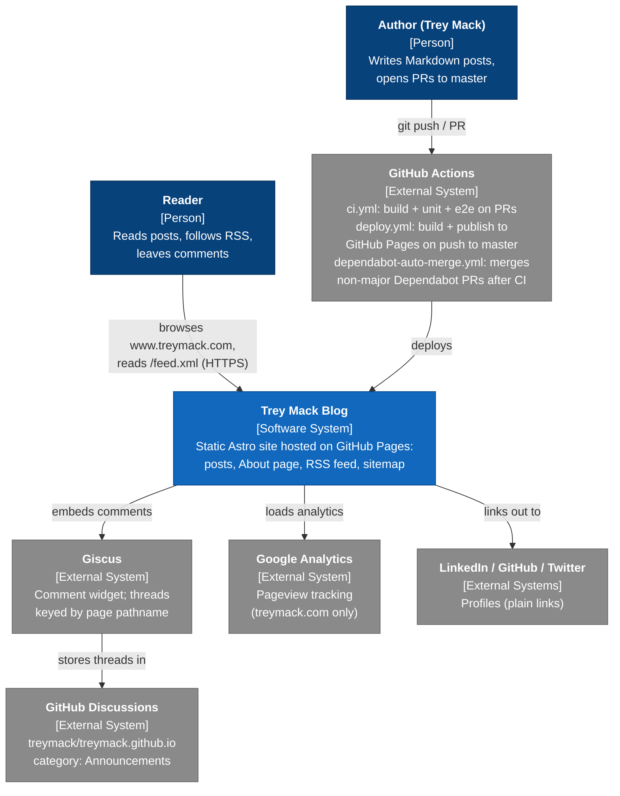
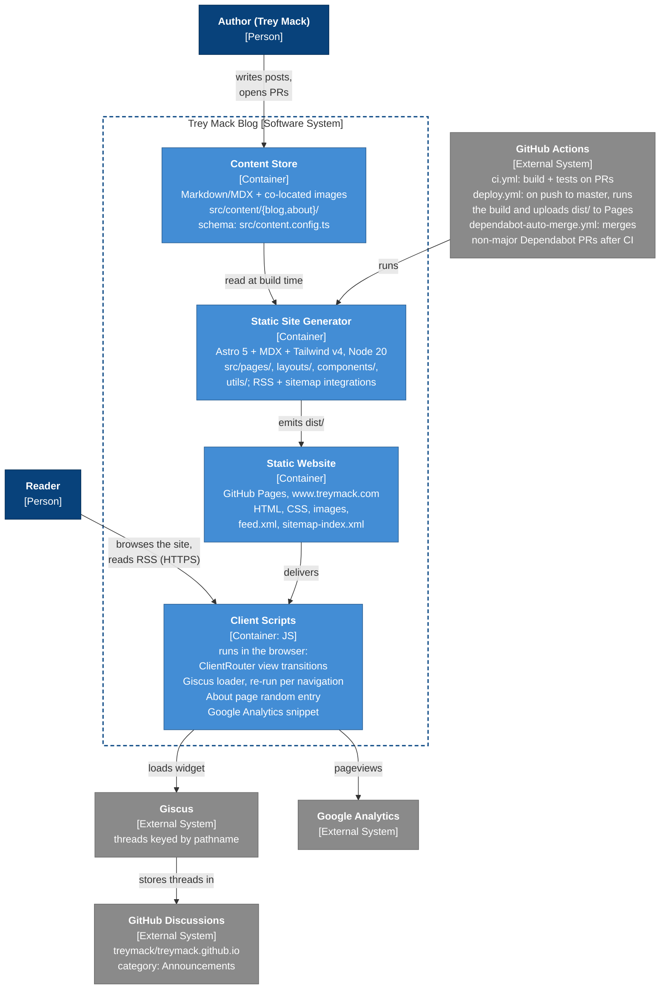

# Architecture

These diagrams follow the [C4 model](https://c4model.com/) at its first two levels:

- **System Context**: the blog, the people who use it, and the external systems it depends on
- **Containers**: the deployable or runnable pieces inside the blog and how they talk to each other

The site is fully static. Astro renders everything to `dist/` at build time, so there is no server or database at runtime. The only code that runs live is the browser JavaScript, which calls out to Giscus and Google Analytics.

Each diagram is drawn in Mermaid, which GitHub renders. Each Mermaid diagram has an ASCII version below it for reading in a terminal or editor. Keep the two in sync.

## System Context



<details>
<summary>ASCII version</summary>

```text
    +----------------------------+                                    +------------------------------+
    | [Person]                   |                                    | [Person]                     |
    | Reader                     |                                    | Author (Trey Mack)           |
    | Reads posts, follows RSS,  |                                    | Writes Markdown posts,       |
    | leaves comments            |                                    | opens PRs to master          |
    +--------------+-------------+                                    +---------------+--------------+
                   | browses www.treymack.com,                                        |
                   | reads /feed.xml (HTTPS)                                          | git push / PR
                   |                                                                  |
                   v                                                                  v
  +================================================+            +------------------------------------+
  | [Software System]                              |            | [External System]                  |
  | Trey Mack Blog                                 |  deploys   | GitHub Actions + Dependabot        |
  | Static Astro site hosted on GitHub Pages:      |<-----------| ci.yml: build + unit + e2e on PRs  |
  | posts, About page, RSS feed, sitemap           |            | deploy.yml: build + publish to     |
  +==========+=============================+===+===+            | GitHub Pages on push to master     |
             |                             |   | links out to   +------------------------------------+
             | embeds comments             |   +----------------------+
             |                             | loads analytics          |
             v                             v                          v
+-------------------------+    +----------------------+   +------------------------+
| [External System]       |    | [External System]    |   | [External Systems]     |
| Giscus                  |    | Google Analytics     |   | LinkedIn / GitHub /    |
| Comment widget; threads |    | Pageview tracking    |   | Twitter profiles       |
| keyed by page pathname  |    | (treymack.com only)  |   | (plain links)          |
+------------+------------+    +----------------------+   +------------------------+
             | stores threads in
             v
+-------------------------------+
| [External System]             |
| GitHub Discussions            |
| treymack/treymack.github.io   |
| category: Announcements       |
+-------------------------------+

Legend:  +====+ system in scope    +----+ person / external system
```

</details>

## Containers



<details>
<summary>ASCII version</summary>

```text
  +----------------------+                                            +------------------------------+
  | [Person]             |                                            | [Person]                     |
  | Reader               |                                            | Author (Trey Mack)           |
  +-----------+----------+                                            +---------------+--------------+
              |                                                                       |
              | browses the site,                                                     | writes posts,
              | reads RSS (HTTPS)                                                     | opens PRs
+=============|== Trey Mack Blog [Software System] ===================================|================+
|             |                                                                       v                |
|             |                                           +--------------------------------------+     |
|             |                                           | Content Store            [Container] |     |
|             |                                           | Markdown/MDX + co-located images     |     |
|             |                                           | src/content/{blog,about}/            |     |
|             |                                           | schema: src/content.config.ts        |     |
|             |                                           +-------------------+------------------+     |
|             |                                                               | read at build time     |
|             |                                                               v                        |
|             |                                           +--------------------------------------+     |
|             |                                           | Static Site Generator    [Container] |     |
|             |                                           | Astro 5 + MDX + Tailwind v4, Node 20 |runs |
|             |                                           | src/pages/, layouts/, components/,   |<-+  |
|             |                                           | utils/; RSS + sitemap integrations   |  |  |
|             |                                           +-------------------+------------------+  |  |
|             |                                                               | emits dist/         |  |
|             v                                                               v                     |  |
| +------------------------------------------+            +--------------------------------------+  |  |
| | Client Scripts           [Container: JS] |  delivers  | Static Website           [Container] |  |  |
| | runs in the browser:                     |<-----------| GitHub Pages, www.treymack.com       |  |  |
| | <ClientRouter/> view transitions         |            | HTML, CSS, images,                   |  |  |
| | Giscus loader, re-run per navigation     |            | feed.xml, sitemap-index.xml          |  |  |
| | About page random entry                  |            +--------------------------------------+  |  |
| | Google Analytics snippet                 |                                                      |  |
| +-----------+----------------------------+-+                                                      |  |
|             | loads widget               | pageviews                                              |  |
+=============|============================|========================================================|==+
              |                            |                                                        |
              v                            v                                                        |
+---------------------------+  +----------------------+     +----------------------------------------+
| [External System]         |  | [External System]    |     | [External System]                      |
| Giscus                    |  | Google Analytics     |     | GitHub Actions + Dependabot            |
| threads keyed by pathname |  +----------------------+     | ci.yml: build + tests on PRs           |
+-------------+-------------+                               | deploy.yml: on push to master, runs    |
              | stores threads in                           | the build and uploads dist/ to Pages   |
              v                                             +----------------------------------------+
+-------------------------------+
| [External System]             |
| GitHub Discussions            |
| treymack/treymack.github.io   |
| category: Announcements       |
+-------------------------------+

Legend:  +====+ system boundary    +----+ person / container / external system
```

</details>

## Keeping this current

Update these diagrams when you add or remove an external service, a content collection, a hosting target, or a GitHub Actions workflow. Changes to individual pages, layouts, components, or utils don't need a diagram update. That level of detail is left out on purpose because it changes too often.
